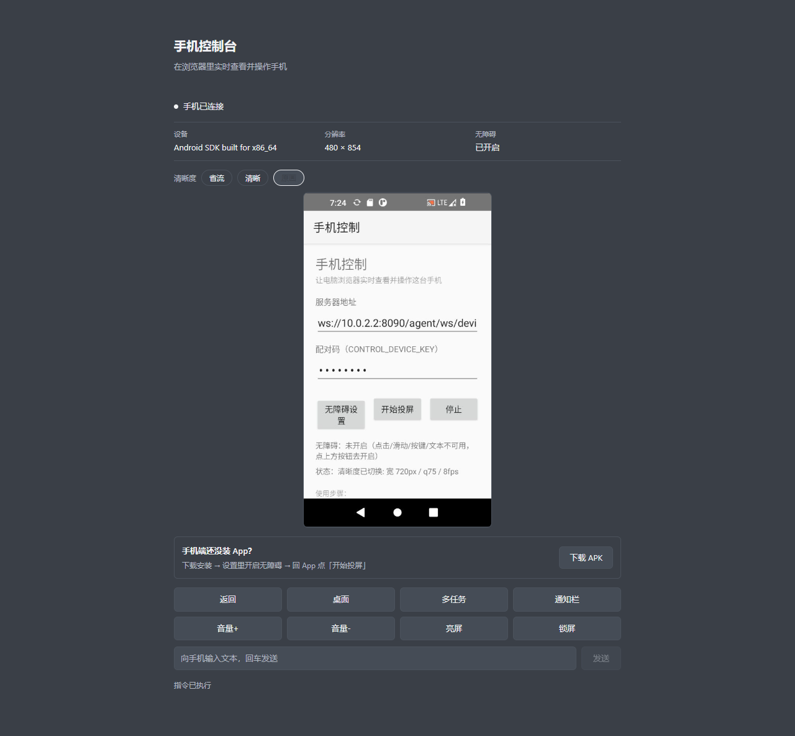

# 手机控制台（phone-control）

手机装一个 App，电脑浏览器就能**实时看到手机屏幕并直接操作手机**。

- 电脑端（线上）：<https://wkeeli.cn/control/> —— 复用 wkeeli.cn 全站登录
- 手机端 APK：[Release 下载][release] → 开启无障碍 → 点「开始投屏」并允许录屏，电脑打开上面的网址即可
- 源码：[github.com/wzqfwanj/phone-control][repo]（MIT）

[release]: https://github.com/wzqfwanj/phone-control/releases/latest
[repo]: https://github.com/wzqfwanj/phone-control



> 上图是真实链路：浏览器的画面就是一台 Android 设备的实时屏幕（304×540 的 JPEG 帧，约 5fps），
> 点击 / 拖动 / 长按 / 按键 / 文本输入都会下发到手机上执行。

## 能做什么（最小功能集）

| 能力 | 说明 |
| --- | --- |
| 实时看屏幕 | MediaProjection 抓屏 → 缩放 → JPEG，仅在有人观看时推流（省电） |
| 点击 / 滑动 / 长按 | 无障碍 `dispatchGesture`，坐标按画面比例归一化 |
| 系统按键 | 返回 / 桌面 / 多任务 / 通知栏 / 音量± / 亮屏 / 锁屏 |
| 文本输入 | 无障碍 `ACTION_SET_TEXT` 写入当前焦点输入框 |
| 在线状态 | 设备名、分辨率、无障碍是否开启、自动重连 |

不做：文件传输、安装 App、录屏保存、多设备同时控制、远程开机。

## 架构

```
手机 App（Android，前台服务 + 无障碍服务）
   │  wss://wkeeli.cn/agent/ws/device?key=<配对码>      （绕过全站 Basic Auth，只认配对码）
   ▼
阿里云 Caddy（wkeeli.cn，全站 Basic Auth / 自动 HTTPS）
   │  /control/*  → 127.0.0.1:18090（剥前缀，走登录）   浏览器页面 + 浏览器 WebSocket
   │  /agent/*    → 127.0.0.1:18090（不剥前缀，免登录）  手机设备 WebSocket
   ▼
dev 主机 frpc 隧道 18090 → 127.0.0.1:8090
   ▼
Python 服务端（单进程 asyncio：HTTP 静态站点 + WebSocket 中继）
```

- 服务端只监听回环地址，公网入口统一由 Caddy 收口；浏览器侧不做登录，复用站点 Basic Auth。
- 一份协议契约：见 [PROTOCOL.md](PROTOCOL.md)（三条链路的所有帧格式与行为约定）。

## 目录

```
├── android/          Android App（纯 Java，无 Gradle、无第三方依赖）+ build.ps1
├── server/           Python 服务端（仅依赖 websockets）
├── web/              Vue 3 + Vite 电脑端控制台（灰底模板，零外部请求）
├── deploy/           systemd / frp / Caddy 部署资产与操作手册
├── tools/            本地联调工具（假设备、浏览器探针、E2E、模拟器脚本）
├── docs/             截图
└── PROTOCOL.md       协议契约（唯一事实源）
```

## 手机端使用

1. 安装 [Release 里的 `phone-control-generic.apk`][release]（不含配对码，需手填），或自己构建；
   **也可以直接在控制台页面上点「下载 APK」**（`/control/phone-control.apk`，由构建时放进 `web/dist` 的版本决定，
   默认优先使用内置配对码的个人版，自己打包含哪些就在 `dist/` 里放哪个）。
2. 打开 App：填**服务器地址** `wss://wkeeli.cn/agent/ws/device`（已预置）和**配对码**（=
   服务端 `CONTROL_DEVICE_KEY`）。
3. 设置 → 无障碍 → 开启「手机控制（远程操作）」，否则点击/滑动/按键/文本不可用。
4. 点「开始投屏」，在系统弹窗里允许录屏。
5. 电脑浏览器打开 <https://wkeeli.cn/control/>，登录后即可看到画面并操作。

> 配对码查看（部署机）：`ssh dev "grep CONTROL_DEVICE_KEY /opt/phone-control/.env"`。
> 想做到「装完即用、不用手填」：新建 `android/private.properties` 写入
> `server.url` 与 `device.key` 后重新构建，配对码会编译进 APK（该文件与 APK 均不入库）。

## 本地开发

```bash
# 1) 服务端（默认 127.0.0.1:8090，静态目录 web/dist）
pip install -r server/requirements.txt
CONTROL_DEVICE_KEY=devkey python server/server.py

# 2) 前端（开发态，WS 走 vite 代理到 8090）
cd web && npm install && npm run dev
#    或构建产物给服务端直接托管
cd web && npm run build

# 3) 没有真机时用假设备联调（生成带时间戳的 JPEG 帧，收到指令回 ack）
python tools/fake_device.py --url ws://127.0.0.1:8090/ws/device --key devkey

# 4) 自动化验证
python server/test_server.py        # 30 个服务端单测
python tools/e2e_test.py            # 真实 server + 假设备 + 无头 Chrome，19 项端到端
```

## 构建 APK

```powershell
# 需要 JDK 17 + Android SDK（platforms;android-34、build-tools;34.0.0、platform-tools）
powershell -ExecutionPolicy Bypass -File android/build.ps1 -Verify
# 产物：android/build/phone-control.apk
```

不依赖 Gradle：`aapt2 compile/link → javac → d8 → 塞 classes.dex → zipalign → apksigner`。

## 部署

见 [deploy/README.md](deploy/README.md)。简述：

1. `powershell -ExecutionPolicy Bypass -File deploy/push.ps1`：上传 `server/` + `web/dist/` 到
   dev 主机 `/opt/phone-control`（保留已有 `.env`），建 venv、装 systemd 并自检 healthz
2. dev 主机 frpc 追加隧道 `8090 → 18090`
3. aliyun Caddy 增加 `/control/*` 与免登录的 `/agent/*`，`caddy validate` 后 reload

## 安全说明

- 浏览器入口：wkeeli.cn 全站 Basic Auth + HTTPS；服务端只监听 127.0.0.1。
- 设备入口：`/agent/*` 免全站登录，但必须携带配对码；配对码随机生成（`openssl rand -hex 16`），
  只存在部署机 `.env`（600），不在仓库里。错误配对码在 WebSocket 握手前 401。
- Android 端 wss 使用系统信任库并**开启主机名校验**（`setEndpointIdentificationAlgorithm("HTTPS")`）。
- 同一时刻只允许一台设备在线，新设备连上会替换旧设备并通知。
- `usesCleartextTraffic=true` 仅为局域网 `ws://` 调试方便；线上请用 `wss://`。

## 已验证范围

- 服务端 30 个单元测试；本地「真实服务端 + 假设备 + 无头 Chrome」19 项端到端全绿。
- Android：APK 构建/签名校验通过；模拟器（Android 11）安装 → 无障碍 → 投屏授权 → 连上服务端
  → 上报 hello → 推 JPEG 帧 → tap/swipe/longpress/按键 全部 ack。
- 线上：手机端经 `wss://wkeeli.cn/agent/ws/device` 成功上线；浏览器侧经 Caddy
  `wss://wkeeli.cn/control/ws/web` 收到真实帧并下发指令收到 ack。

## 已知限制

- MediaProjection 出帧由画面变化驱动：屏幕长时间静止时不会有新帧（5fps 只是上限）。
- 无障碍授权各家 ROM 路径略有差异；部分 ROM 需要「允许后台运行」才不会被杀。
- 锁屏（sleep）需 Android 9+；回车（enter）需 Android 11+。
- 未在真机 / Android 14 真机上验证过完整流程（代码按 Android 14 的前台服务顺序要求实现）。

## 许可

MIT，见 [LICENSE](LICENSE)。
